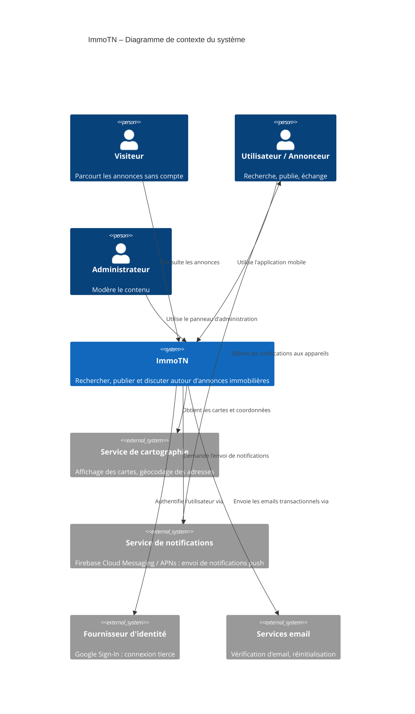

# C4 – Niveau 1 : diagramme de contexte

Système central : **ImmoTN** (nom provisoire), application permettant de rechercher, publier et discuter autour d'annonces immobilières.

## Éléments (source : dossier de conception, § 4.1)

| Élément | Type | Description | Relation avec le système |
|---|---|---|---|
| Visiteur | Personne | Parcourt les annonces sans compte | Consulte les annonces |
| Utilisateur / Annonceur | Personne | Recherche, publie, échange | Utilise l'application mobile |
| Administrateur | Personne | Modère le contenu | Utilise le panneau d'administration |
| Service de cartographie | Système externe | Affichage des cartes, géocodage des adresses | Fournit les cartes et coordonnées |
| Service de notifications (FCM / APNs) | Système externe | Envoi de notifications push | Délivre les notifications aux appareils |
| Fournisseur d'identité (Google Sign-In) | Système externe | Connexion tierce | Authentifie l'utilisateur |
| Services email | Système externe | Vérification d'email, réinitialisation | Envoie les emails transactionnels |

Le choix du service de cartographie (Google Maps ou OpenStreetMap dans le PDF) n'est pas fixé ici : le `README.md` installe `google_maps_flutter` (Flutter) et `react-native-maps` (React Native).
