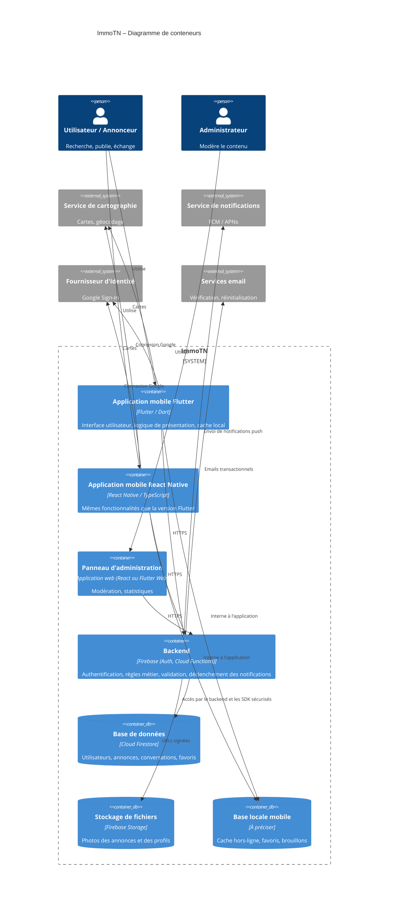

# C4 – Niveau 2 : diagramme de conteneurs

Backend retenu : **Firebase**, commun aux deux applications (choix recommandé par le PDF, repris par le `README.md`).

## Conteneurs (source : dossier de conception, § 4.2)

| Conteneur | Technologie | Responsabilité | Communication |
|---|---|---|---|
| Application mobile Flutter | Flutter / Dart | Interface utilisateur, logique de présentation, cache local | HTTPS vers le backend |
| Application mobile React Native | React Native / TypeScript | Mêmes fonctionnalités que la version Flutter | HTTPS vers le backend |
| Backend (API) | Firebase (Auth, Cloud Functions) | Authentification, règles métier, validation, déclenchement des notifications | HTTPS/REST ou SDK |
| Base de données | Cloud Firestore | Utilisateurs, annonces, conversations, favoris | Accès par le backend et les SDK sécurisés |
| Stockage de fichiers | Firebase Storage | Photos des annonces et des profils | URLs signées |
| Panneau d'administration | Application web (React ou Flutter Web) | Modération, statistiques | HTTPS vers le backend |
| Base locale mobile | SQLite / Hive / AsyncStorage (non tranché) | Cache hors-ligne, favoris, brouillons | Interne à l'application |

Le panneau d'administration est marqué « optionnel » dans le `README.md` (`admin-web/`) alors que le PDF le liste comme conteneur : voir « Points ouverts ».
