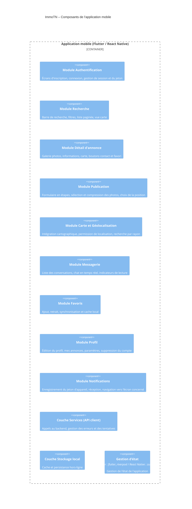
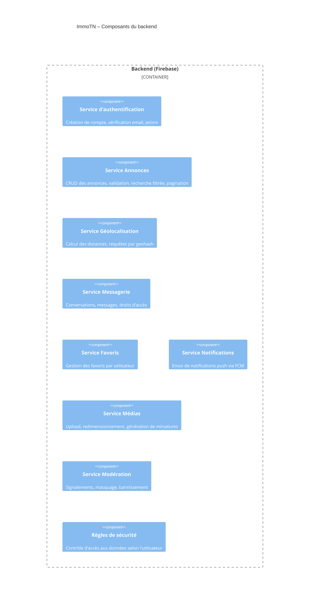

# C4 – Niveau 3 : diagrammes de composants

Le PDF décrit les composants sans préciser leurs relations internes. Les diagrammes montrent donc uniquement les composants et leur rôle, sans flèches inventées.

## a) Application mobile (même logique pour Flutter et React Native)

## b) Backend

## Composants (source : dossier de conception, § 4.3)

| Application mobile | Rôle |
|---|---|
| Module Authentification | Écrans d'inscription, connexion, gestion de session et du jeton |
| Module Recherche | Barre de recherche, filtres, liste paginée, vue carte |
| Module Détail d'annonce | Galerie photos, informations, carte, boutons contact et favori |
| Module Publication | Formulaire en étapes, sélection et compression des photos, choix de la position |
| Module Carte et Géolocalisation | Intégration cartographique, permission de localisation, recherche par rayon |
| Module Messagerie | Liste des conversations, chat en temps réel, indicateurs de lecture |
| Module Favoris | Ajout, retrait, synchronisation et cache local |
| Module Profil | Édition du profil, mes annonces, paramètres, suppression du compte |
| Module Notifications | Enregistrement du jeton d'appareil, réception, navigation vers l'écran concerné |
| Couche Services (API client) | Appels au backend, gestion des erreurs et des tentatives |
| Couche Stockage local | Cache et persistance hors-ligne |
| Gestion d'état | Flutter : flutter_riverpod ; React Native : zustand (choix du `README.md`) |

Le PDF cite pour le backend « geohash ou PostGIS » ; seul le geohash est retenu, car le `README.md` choisit Firebase et le geohash (étapes 7 et 8).
