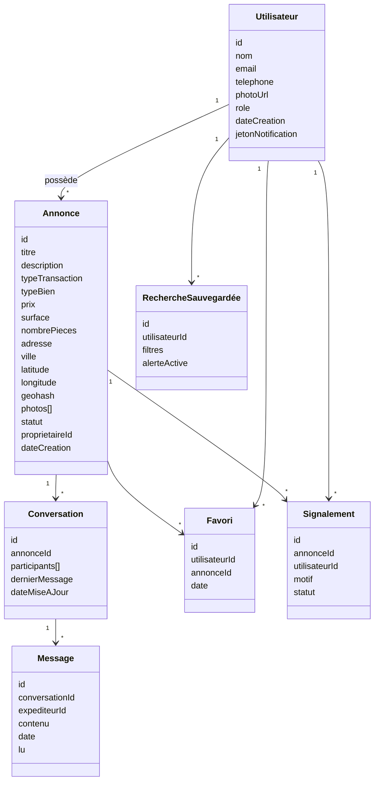

# C4 – Niveau 4 : modèle de données

Niveau facultatif en C4 ; illustré ici par le modèle de données et les classes principales du dossier de conception (§ 4.4), complété par l'entité `RechercheSauvegardée` (confirmée).

## Entités et attributs (source : dossier de conception, § 4.4)

Les noms du diagramme sont écrits sans accents pour la compatibilité Mermaid (`dateCréation` → `dateCreation`, `rôle` → `role`, etc.).

| Entité | Attributs principaux |
|---|---|
| Utilisateur | id, nom, email, téléphone, photoUrl, rôle (utilisateur, agence, admin), dateCréation, jetonNotification |
| Annonce | id, titre, description, type de transaction (vente, location), type de bien (appartement, villa, terrain, local, etc.), prix, surface, nombrePièces, adresse, ville, latitude, longitude, geohash, photos[], statut (active, vendue, masquée), propriétaireId, dateCréation |
| Conversation | id, annonceId, participants[], dernierMessage, dateMiseAJour |
| Message | id, conversationId, expéditeurId, contenu, date, lu |
| Favori | id, utilisateurId, annonceId, date |
| RechercheSauvegardée | id, utilisateurId, filtres, alerteActive |
| Signalement | id, annonceId, utilisateurId, motif, statut |

## Relations

Énoncées explicitement dans le PDF :
- un Utilisateur possède plusieurs Annonces ;
- une Annonce peut avoir plusieurs Conversations et plusieurs Favoris ;
- une Conversation contient plusieurs Messages.

Déduites des attributs de clé (`utilisateurId`, `annonceId`, …), non énoncées en toutes lettres : Utilisateur → Favori, Utilisateur → RechercheSauvegardée, Annonce → Signalement, Utilisateur → Signalement.

Le lien Message → expéditeur (`expéditeurId`) et Conversation ↔ Utilisateur (`participants[]`) existe dans les attributs mais n'est pas dessiné, pour garder le diagramme lisible.

## Collections Firestore citées par le `README.md`

`users`, `listings`, `favorites`, `conversations` (règles de l'étape 3). Les noms de collections pour messages, recherches sauvegardées et signalements ne sont pas précisés : voir « Points ouverts ».
